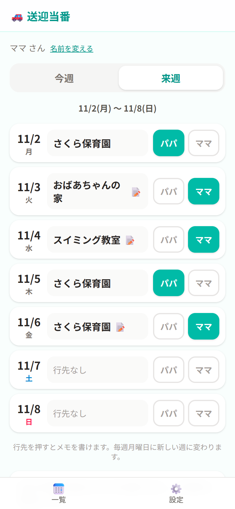
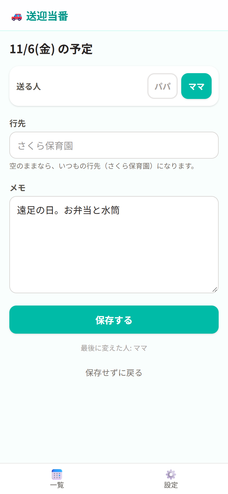
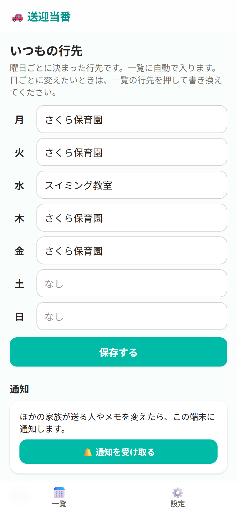
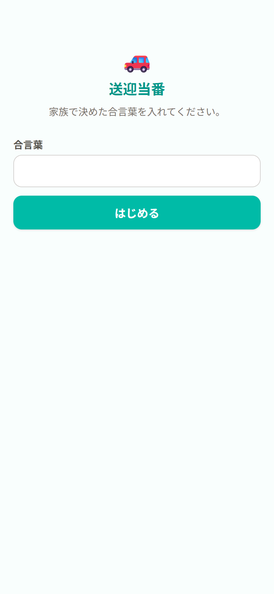

# 送迎当番

子どもを保育園や習い事に「今日は誰が送るか」を、家族で 1 つの画面にまとめる Web アプリです。
LINE で「明日どっちが送る？」とやり取りする代わりに、パパ/ママのボタンを押すだけで決まり、変わったら家族のスマホに通知が届きます。

- 公開 URL: https://pickup-next.vercel.app （家族の合言葉が必要です）
- 使うのは自分と家族だけなので、アカウントは作らず、家族で決めた合言葉 1 つで使います。

| 一覧（来週）                     | 日ごとの詳細・メモ                       | 設定                                     | 合言葉                               |
| -------------------------------- | ---------------------------------------- | ---------------------------------------- | ------------------------------------ |
|  |  |  |  |

※ スクリーンショットはサンプルのデータです。

## できること

- **送る人**: 各日の「パパ」「ママ」を押すと光り、もう一度押すと消えます（1 日 1 人）。
- **行先**: 曜日ごとの「いつもの行先」が自動で入ります。日ごとに書き換えることもできます。
- **メモ**: 行先を押すと、その日の詳細を書けます。メモがある日は一覧に 📝 が付きます。
- **今週・来週**: 月〜日の 1 週間を一覧で表示し、毎週月曜 0:00（日本時間）に新しい週に変わります。来週の分も先に決められます。
- **通知**: ほかの家族が送る人・行先・メモを変えると、スマホにプッシュ通知が届きます（変えた本人には届きません）。iPhone は「ホーム画面に追加」して開くと通知を受け取れます。

## 技術スタック

| 分野           | 使ったもの                                                                                     |
| -------------- | ---------------------------------------------------------------------------------------------- |
| フレームワーク | Next.js 16（App Router・Server Actions・Proxy・Cache Components・`after()`）/ React 19 / TypeScript |
| スタイル       | Tailwind CSS 4                                                                                 |
| データベース   | Supabase（Postgres。無料プラン）                                                               |
| 通知           | Web Push（Service Worker + VAPID、`web-push` ライブラリ）・PWA（Web App Manifest）             |
| ホスティング   | Vercel（Hobby プラン・東京リージョン）                                                         |
| テスト         | Vitest                                                                                         |
| 開発           | Claude Code                                                                                    |

## しくみ

- **合言葉**: 正しい合言葉を入れると、合言葉から作った署名（HMAC-SHA256）を HttpOnly の Cookie に 1 年間保存します。`src/proxy.ts` がすべてのページの前で確かめます。
- **データ**: Supabase にはサーバー（Server Actions / Server Components）からだけ secret キーでつなぎます。テーブルは RLS をオンにしてポリシーを作っていないので、ブラウザ用のキーでは読み書きできません。
- **週と日付**: Vercel のサーバーは UTC で動くので、「今日」は日本時間で決めています（`src/lib/week.ts`）。記録は消さず、「今日を含む週」を表示することで月曜にリセットされます。
- **行先**: 日ごとの上書き → 曜日ごとのいつもの行先、の順に決まります。
- **通知**: 端末ごとの購読（endpoint）を名前と一緒に保存し、変更があったら Server Action の `after()` で応答のあとに送ります。届かなくなった端末（404/410）は自動で消します。

## 手元で動かす

```bash
npm install
cp .env.example .env.local   # 値を入れる
npx web-push generate-vapid-keys   # 通知の鍵を作る
npm run dev                  # http://localhost:3000
npm test
```

### 環境変数

| 名前                           | 内容                                                              |
| ------------------------------ | ----------------------------------------------------------------- |
| `APP_PASSWORD`                 | 家族の合言葉（半角英数字。iPhone のパスワード欄でも打てるように） |
| `SUPABASE_URL`                 | Supabase のプロジェクトの URL                                     |
| `SUPABASE_SECRET_KEY`          | Supabase の secret キー（`sb_secret_…`）。ブラウザには渡さない    |
| `NEXT_PUBLIC_VAPID_PUBLIC_KEY` | 通知の公開鍵（ビルド時に埋め込まれる）                            |
| `VAPID_PRIVATE_KEY`            | 通知の秘密鍵                                                      |
| `VAPID_SUBJECT`                | 連絡先（`mailto:` か `https://` の URL）                          |

### データベース

Supabase の SQL Editor で [`docs/schema.sql`](docs/schema.sql) を実行します。

## ドキュメント

- [要件定義書](docs/requirements.md)
